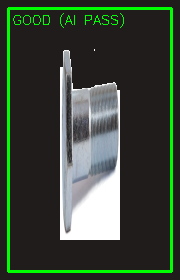
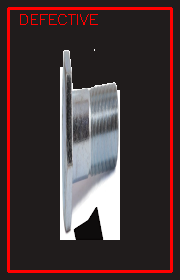

# VisionScrew AOI

**Otomatik Optik Muayene (Automated Optical Inspection) sistemi** — OpenCV ve Pandas ile hasarlı vida tespiti, gerçek zamanlı konveyör simülasyonu ve fabrika hattı loglama.

Endüstriyel montaj hatlarında vidaların görsel kalite kontrolünü otomatikleştirmek için geliştirilmiştir. Referans vida görüntüleri bellek içi batch olarak yüklenir, stüdyo arka planı şeffaf hale getirilir ve bant üzerindeki parçalar AI denetim bölgesinden geçerken **GOOD / DEFECTIVE** olarak sınıflandırılır.

**Geliştirici:** Mehmet Bugra Altuntas (225060043)

---

## Özellikler

- **Gerçek vida varlıkları:** `data/reference/` altındaki referans görüntüler (drill, hex bolt, wood screw vb.) batch ön-işlemeden geçirilir.
- **Şeffaf silüet (RGBA):** Stüdyo beyaz/açık gri arka plan kaldırılır; vida gövdesi katı ve opak kalır.
- **Sentetik hata üretimi:** Kırık uç, pas/korozyon ve yamukluk (affine warp) yalnızca sağlam referanslar üzerinden üretilir. Eski sentetik örnek klasörü kullanılmaz.
- **Lazer denetim bariyeri:** Y=250 ve Y=450 kırmızı çizgiler arasında AI Inspection Zone.
- **Sınıflandırma:** Yalnızca sentetik olarak bozulmuş vidalar kırmızı çerçeve alır; sağlam parçalar yeşil **GOOD (AI PASS)** etiketi taşır.
- **Hat hızı ve oran:** Akıcı şelale akışı (~4–5 px/kare). Hatalı vida hedefi yaklaşık **dakikada 12 adet** (her ~5 saniyede bir).
- **Hız kamerası kaydı:** DEFECTIVE tespitinde kırpılmış vida görüntüsü `detected_defects/` klasörüne zaman damgalı olarak kaydedilir (`defect_YYYYMMDD_HHMMSS.jpg`).
- **Sistem log paneli:** 1300×700 arayüz — sol 900×700 konveyör, sağ 400×700 terminal tarzı log alanı. Mersin / Toros Endüstriyel Bant Hat-1 konum kaydı.
- **Statik AOI analizi:** `main.py` + `defect_detector.py` ile referans–test görüntüsü fark analizi (MSE, kontur, hata işaretleme).

### Muayene çıktısı örnekleri

Sağlam vida (yeşil çerçeve / AI PASS):



Hasarli vida (kirmizi çerçeve / AI REJECT):



---

## Kullanılan Teknolojiler

| Bileşen | Rol |
| --- | --- |
| **Python 3.10+** | Uygulama dili |
| **OpenCV (`cv2`)** | Görüntü okuma, maskeleme, Canny, alpha blending, gerçek zamanlı pencere |
| **NumPy** | Matris işlemleri, konveyör arka planı ve özellik çıkarımı |
| **Pandas** | Muayene kayıtlarının tablo halinde işlenmesi ve raporlama altyapısı |
| **datetime / os** | Mersin hat logları, zaman damgalı snapshot ve klasör yönetimi |

---

## Proje Yapısı

```text
VisionScrew_AOI/
├── vision_screw_aoi_v2.py   # Gerçek zamanlı fabrika simülasyonu (AOI V2)
├── main.py                  # Statik referans–test muayene döngüsü
├── defect_detector.py       # Fark analizi ve hata konumlandırma
├── defect_generator.py      # Sentetik hata üretim yardımcıları
├── utils.py                 # Görüntü karşılaştırma yardımcıları
├── requirements.txt
├── data/
│   └── reference/           # Sağlam vida referans görüntüleri
├── detected_defects/        # Çalışma anında kaydedilen hatalı parçalar
└── images/                  # README ekran görüntüleri
```

---

## Kurulum

### 1. Depoyu klonlayın

```bash
git clone <REPO_LINKI>
cd VisionScrew_AOI
```

### 2. Sanal ortam (önerilir)

**Windows (PowerShell):**

```powershell
python -m venv venv
.\venv\Scripts\Activate.ps1
```

**Linux / macOS:**

```bash
python3 -m venv venv
source venv/bin/activate
```

### 3. Bağımlılıkları yükleyin

```bash
pip install -r requirements.txt
```

Referans vida görüntülerinin `data/reference/` içinde bulunduğundan emin olun (`drill_screw.webp`, `hex_bolt.webp`, `wood_screw.webp` vb.).

İsteğe bağlı fabrika arka planı: proje köküne veya `data/` altına `factory_bg.jpg` koyabilirsiniz. Dosya yoksa sistem koyu gri endüstriyel bant arka planına düşer.

---

## Nasıl Çalıştırılır

### Gerçek zamanlı konveyör simülasyonu (önerilen vitrin)

```powershell
python vision_screw_aoi_v2.py
```

- Pencere: **VisionScrew AOI V2 – Autonomous Factory Simulation**
- Çıkış: **Q** veya **ESC**
- Hatalı parça fotoğrafları otomatik olarak `detected_defects/` altına yazılır.

### Statik görüntü muayenesi

```powershell
python main.py
```

Referanslar `data/reference/` ile `data/synthetic_samples/` altındaki test görüntüleri eşleştirilir. Pencere açıkken bir sonraki örneğe geçmek için herhangi bir tuşa, çıkmak için **ESC** kullanın.

### Sentetik hata seti üretmek (opsiyonel)

```powershell
python defect_generator.py
```

---

## Çalışma Prensibi (Kısa)

1. **Batch ön yükleme:** Referans vidalar RAM’e alınır, arka plan temizlenir, RGBA sprite üretilir.
2. **Hat simülasyonu:** Vidalar konveyör üzerinde aşağı akar; çoğunluk yeşil (GOOD) geçer.
3. **AI tetikleyici:** Vida iki kırmızı lazer çizgisi arasına girdiğinde karar verilir.
4. **Red ve kayıt:** DEFECTIVE parçalar kırmızı çerçevelenir, log paneline yazılır ve snapshot diske kaydedilir.

Örnek log satırı:

```text
[LOG] 2026-06-09 03:04:50 | Konum: Mersin - Hat 1 | DURUM: HATALI URUN KAYDEDILDI
```

---

## Lisans

Bu depo eğitim ve portföy amaçlıdır. Endüstriyel kullanımda kamera kalibrasyonu, aydınlatma ve hat PLC entegrasyonu ayrıca tasarlanmalıdır.
